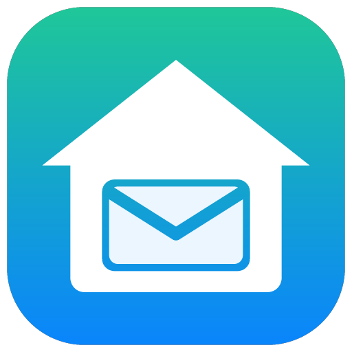

# Homepost

**Your mail, fetched by your own Home Assistant.** A clean, iOS-Mail-style mail app that lives inside Home Assistant: as a sidebar panel, as a dashboard card, and as a stand-alone web app you can put on your phone's home screen.

[Nederlands](README.nl.md)

## Why

- **Privacy** – your mail goes from your provider straight to your own Home Assistant. No third-party mail app, no cloud service in between, no tracking pixels (they are filtered out).
- **Battery** – the phone doesn't poll mail servers. Home Assistant does that at home; the phone only shows what's there.
- **Notifications right away** – Home Assistant fires an event for every new message, so you can notify any device, flash a light, or announce it on a speaker.
- **One place** – all your accounts (Gmail, iCloud, Outlook, your own domain) in one inbox, next to the rest of your home.

## Features

- All Inboxes, per-account inboxes and every folder (Drafts, Sent, Junk, Trash, Archive, custom folders) with counters
- Read messages safely: HTML is sanitised and shown in a sandbox without scripts; remote images on/off; tracking pixels removed
- Swipe actions like iOS: archive, delete, read/unread; flag; move back to the inbox
- Write, reply, reply all and forward (with attachments of the original), per-account signature and colour
- Address suggestions from your inbox and sent mail
- Search (server-side, Gmail search syntax works for Gmail)
- A sensor per account with the number of unread messages, and a `homepost_new_mail` event
- Per account you choose which Home Assistant users may use it (default: administrators only)
- English and Dutch

## Installation

### 1. Install with HACS

1. In Home Assistant open **HACS**, open the ⋮ menu → **Custom repositories**.
2. Add `https://github.com/dadalouis/ha-homepost` with type **Integration**.
3. Search for **Homepost**, click **Download**, then **restart Home Assistant**.

Manual installation

Copy `custom_components/homepost` into the `custom_components` folder of your Home Assistant configuration and restart.

### 2. Add a mail account

**Settings → Devices & services → Add integration → Homepost.** Pick your provider and enter your address and password. Homepost tests the login (receiving *and* sending) before it saves anything. Add more accounts the same way.

**Gmail and iCloud** no longer accept your normal password in other mail apps. They need a one-time *app password*; Homepost shows the steps with direct links:

1. Turn on 2-Step Verification ([Google](https://myaccount.google.com/signinoptions/twosv)) – a confirmation on your phone is enough.
2. Create an app password ([Google](https://myaccount.google.com/apppasswords) / [Apple](https://account.apple.com/account/manage)), name it "Home Assistant".
3. Paste it into Homepost. Spaces are fine.

Most other providers (your own domain, ISP mail) work with your normal password. Outlook/Hotmail often only allow modern sign-in; adding such an account may fail.

### 3. Open the app

- **Sidebar**: a **Homepost** item appears in the sidebar.
- **Dashboard card**: add a card of type `custom:homepost-card` (best in a view of type *Panel*).
- **On your phone's home screen**: open `https://<your-home-assistant>/homepost-files/app.html` in Safari/Chrome, log in with your Home Assistant account, then *Share → Add to Home Screen*.

### 4. Notifications (optional)

- **Companion app**: import the blueprint
  
  and pick your phone.
- **Web push to the home-screen app**: set up the Home Assistant [HTML5 push](https://www.home-assistant.io/integrations/html5/) integration; the web app then offers a "Turn on" button and a red badge with the unread count.
- **Your own automations**: trigger on the event `homepost_new_mail`. Data: `account`, `account_name`, `account_email`, `uid`, `from_name`, `from_address`, `subject`, `preview`, `message_id`, `date`, `unread`.

## Access from outside your home

Homepost uses your normal Home Assistant address and login, so it works wherever Home Assistant works:

| How you reach Home Assistant | Reading & writing | Notifications, badge, home-screen app |
|---|---|---|
| Home Assistant Cloud (Nabu Casa) | ✅ | ✅ easiest |
| Your own domain with HTTPS (Cloudflare Tunnel, reverse proxy) | ✅ | ✅ |
| VPN (WireGuard, Tailscale, …) to an `https://` address | ✅ | ✅ |
| Only `http://<ip>:8123` at home | ✅ | ❌ browsers require HTTPS for these |

## How it works

- Each mail account is a config entry. The password is stored only in your Home Assistant (like any other integration) and is never logged.
- Messages are fetched on demand straight from the IMAP server; nothing is written to Home Assistant states or the database except the unread counter.
- The app talks to Home Assistant over the websocket API (`homepost/*` commands). Every command checks whether the logged-in Home Assistant user may use that account.
- Sending uses SMTP with the same login. For servers that don't keep a copy themselves, Homepost saves one in the Sent folder.
- Every account's inbox is checked every 60 seconds (adjustable in the account options) with a single light-weight `STATUS` command.
- At most 20 messages can be sent per hour, as a safety net.

## About

Homepost started as a personal project: a Home Assistant user wanted a mail app on the phone that didn't hand mail to another cloud service and didn't drain the battery, and built it together with Claude (Anthropic's AI assistant). It is shared here in the hope it is useful to others.

Feedback and pull requests are welcome via [issues](https://github.com/dadalouis/ha-homepost/issues).

## License

MIT
